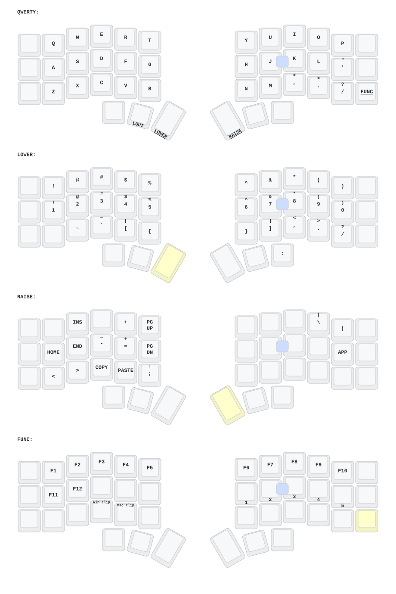

# Alejandro's Corne ZMK config

One keymap, two keyboards:

| Keyboard | Keys | Keymap file |
|---|---|---|
| Typeractive Corne (classic, nice!nano v2 + nice!view) | 42 | `config/corne.keymap` |
| Alibaba Corne (Eyelash) | 42 + joystick + knob | `config/eyelash_corne.keymap` |

**Edit keys in `config/corne_shared.dtsi`.** Both keyboards use it, so they always match.
The Eyelash file only adds the joystick/knob extras (arrows and Enter on base, mouse on NUMBER/SYMBOL,
RGB on CTRL, knob = volume / scroll).

Every push builds firmware for both in GitHub Actions. Download the zip from the run:

- `Typeractive-Corne-left` / `Typeractive-Corne-right` → classic Corne
- `Alibaba-Corne-left` / `Alibaba-Corne-right` → Eyelash Corne
- `Alibaba-Corne-left-studio` → Eyelash left with ZMK Studio enabled (optional)
- `settings_reset` → flash to each half to clear Bluetooth pairings (works on both)

## Keymap

Drawn automatically by [keymap-drawer](https://github.com/caksoylar/keymap-drawer) on every push that touches `config/`
(the `[Draw]` commits). Don't edit the files in `keymap-drawer/` by hand.
It shows the 42 shared keys, which are the same on both keyboards.

Layout inspired by [markstos' Corne layout](https://mark.stosberg.com/markstos-corne-3x5-1-keyboard-layout/).
